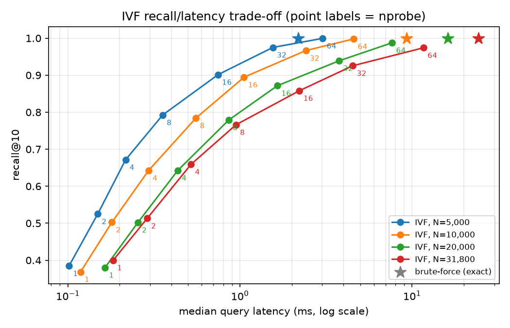

# RAG Agent

[](https://github.com/rmouahid/rag-agent/actions/workflows/ci.yml)

A minimal but precise Retrieval-Augmented Generation (RAG) agent built from scratch in Python — no LangChain, no managed vector database, no external ANN library.

## Features

- Multi-source ingestion (PDF, Markdown, Web)
- Custom chunking & embedding pipeline, built without a framework
- Vector search built from scratch with numpy: exact brute-force cosine search, and an IVF index (own k-means, configurable `nprobe`, incremental updates)
- Answer generation via a locally-hosted LLM — no external inference API

## Stack

- Python 3.11+
- llama.cpp via `llama-cpp-python` (local LLM, CPU-friendly GGUF weights)
- sentence-transformers (embeddings)
- numpy (vector search)

## Package layout

```
rag_agent/
├── ingestion/    # Source loaders (PDF, Markdown, web)
├── chunking/     # Text chunking
├── vectorstore/  # Embeddings, vector store, retrieval
├── generation/   # LLM-backed answer generation (RAGAgent)
├── api/          # FastAPI service (app, routers, dependencies)
└── pipeline.py   # Ingestion pipeline: source → indexed, searchable chunks
```

Ingestion goes through a single entry point, `IngestionPipeline`:
source → loader (picked from the file extension or URL) → chunker →
deduplication (against the batch and the indexed corpus) → embeddings →
vector store. `pipeline.ingest(path_or_url)` returns an `IngestionResult`
(new chunk ids, chunks produced, duplicates skipped);
`pipeline.ingest_document(document)` takes an already-loaded `Document`.
`RAGAgent` owns one, sharing the retriever's chunker, embedder and store,
so the CLI and the `POST /documents` endpoint both ingest through it.

Import everything via `rag_agent.*`, e.g. `from rag_agent.generation.rag_agent import RAGAgent`.

## Local LLM

Answers are generated by a model running on your machine with llama.cpp
(see [ADR 0001](docs/ADR/0001-local-llm-runtime.md) for why). No API key,
no external inference service; the weights are a GGUF file on disk.

The default model is **Llama-3.2-3B-Instruct** (`Q4_K_M`, ~2 GB):

```bash
poetry run hf download bartowski/Llama-3.2-3B-Instruct-GGUF \
    Llama-3.2-3B-Instruct-Q4_K_M.gguf --local-dir models
```

`LOCAL_MODEL_PATH` points to it by default. To use another model, such as
`Llama-3.1-8B-Instruct` on a machine with more RAM, download its GGUF file
and change `LOCAL_MODEL_PATH`. No code change is needed. If the file is
missing, the agent stops at startup and prints the command above.

The prompt template (instructions, retrieved context with sources, recent
conversation history) lives in `rag_agent/generation/prompt.py`, apart
from the retrieval and generation code.

The prompt must fit in `LLM_CONTEXT_SIZE - LLM_MAX_TOKENS - LLM_CONTEXT_MARGIN`
tokens, so the answer always has room. When it would not, the least
relevant retrieved chunks are left out first (the best one is always kept),
then the oldest conversation exchanges. If the question and the best chunk
alone still overflow, the agent reports it instead of answering ungrounded.

Retrieved chunks scoring below `MIN_RELEVANCE_SCORE` are discarded. If none
is left, the agent answers that the indexed documents do not cover the
question, without calling the LLM, rather than letting it make an answer up.
With `all-MiniLM-L6-v2`, on-topic passages typically score 0.3 to 0.7 and
off-topic ones below 0.2.

`RAGAgent.ask` returns an `Answer`: the generated text plus the sources
actually placed in the prompt (source, excerpt, chunk id and similarity
score), so every answer can be checked against what the model was shown.
The CLI prints them as a numbered list under the answer.

`RAGAgent.ask_stream` is the streaming counterpart: it returns a
`StreamingAnswer` whose sources are known before the first token and
which yields the text as the model produces it (`LocalLLM.stream`). The
CLI uses it, so answers appear word by word.

| Variable | Default | Meaning |
|---|---|---|
| `LOCAL_MODEL_PATH` | `models/Llama-3.2-3B-Instruct-Q4_K_M.gguf` | GGUF weights |
| `LLM_CONTEXT_SIZE` | `4096` | Context window in tokens (prompt + answer) |
| `LLM_MAX_TOKENS` | `512` | Maximum tokens generated per answer |
| `LLM_TEMPERATURE` | `0.2` | Sampling temperature; low keeps answers close to the context |
| `LLM_CONTEXT_MARGIN` | `64` | Tokens kept free for the chat template around the prompt |
| `LLM_THREADS` | `0` | CPU threads, `0` lets llama.cpp choose |
| `HISTORY_TURNS` | `3` | Previous question/answer exchanges recalled in the prompt, `0` for none |
| `MIN_RELEVANCE_SCORE` | `0.25` | Minimum cosine similarity for a chunk to be used as context |

## Vector search

Two search backends, selected with `INDEX_TYPE` (see `.env.example`):

| `INDEX_TYPE` | How it works | When to use it |
|---|---|---|
| `brute-force` (default) | Exact cosine similarity against every stored vector. | Small corpora, and as the correctness baseline. |
| `ivf` | Inverted file index: a k-means (implemented from scratch) splits the vectors into `IVF_NLIST` lists; a query only scans the `NPROBE` lists whose centroids are closest to it. | Larger corpora, where scanning every vector gets slow. |

The index is persisted next to the store (`ivf_index.npz`) and reloaded on
startup; a missing or out-of-sync index is rebuilt automatically.

With `INDEX_TYPE=ivf`, a store smaller than **`IVF_MIN_VECTORS`** (default
`10000`) still searches by brute force and builds no index: at that size an
exact scan takes a few milliseconds (2 ms at 5,000 vectors in the
[benchmark](docs/benchmarks/ivf.md)), so the index would only cost recall
(0.79 at `NPROBE=8`) for no noticeable gain. The index is built by the
ingestion that reaches the threshold, and the store switches to it from
then on. Set `IVF_MIN_VECTORS=0` to use the index at any size.

- **`IVF_NLIST`**: number of lists. `0` (default) picks about `sqrt(N)`.
- **`NPROBE`**: lists scanned per query, which trades speed for recall. Higher
  values give better recall but slower queries, and `NPROBE = IVF_NLIST` returns
  exactly the brute-force results. It can also be overridden per query with
  `VectorStore.search(..., nprobe=...)`.

### Incremental updates vs. rebuilds

Re-running k-means every time a document is ingested would cost a full
pass over the corpus. So newly-ingested chunks are instead **filed into the
list of their nearest existing centroid**, and the centroids stay put. This
is cheap, but the centroids were fitted on the corpus as it was at build
time:

- if new documents cover the **same topics**, the old centroids still fit
  them. Recall barely moves, but the lists grow, and so does query latency.
- if new documents cover **new topics**, the new vectors get crammed into
  lists centred elsewhere. Recall then drops quickly, because a query about the
  new topic probes lists that are not the ones holding its neighbours.

To bound this drift, the store counts the vectors added since the last
build and **rebuilds the index from scratch** (new k-means, `IVF_NLIST`
re-derived from the new size) once they exceed `IVF_REBUILD_THRESHOLD`
of the index (default `0.2`, i.e. 20%). A lower threshold keeps recall
closer to a fresh index at the cost of more frequent rebuilds; a higher
one rebuilds less often but tolerates more drift. `VectorStore.rebuild_index()`
forces a rebuild at any time.

### Benchmark: brute-force vs. IVF

Measured on **31,800 real chunks**: 40 public-domain books from Project
Gutenberg, split with the project's fixed-size chunker (500 characters)
and embedded with `all-MiniLM-L6-v2` (384 dimensions). The machine has a
single CPU core. Recall@10 is measured against the exact brute-force
top-10, over 200 held-out queries.

| Method | nprobe | Vectors scanned | Recall@10 | Median latency | Speed-up |
|---|---:|---:|---:|---:|---:|
| brute-force | — | 100% | 1.000 | 24.3 ms | 1x |
| IVF (178 lists) | 4 | 2.6% | 0.659 | 0.52 ms | 47x |
| IVF | 8 | 5.1% | 0.766 | 0.95 ms | 26x |
| IVF | 16 | 10.0% | 0.858 | 2.21 ms | 11x |
| IVF | 32 | 19.5% | 0.926 | 4.52 ms | 5.4x |
| IVF | 64 | 37.9% | 0.974 | 11.65 ms | 2.1x |



- `NPROBE` is the recall/latency knob. At this corpus size, `NPROBE=32`
  keeps over 92% of the exact neighbours while being about 5x faster than
  brute-force. The default `NPROBE=8` favours speed, at 0.77 recall.
- At a fixed `nprobe`, recall slowly decreases as the corpus grows, because
  the number of lists grows with it (about `sqrt(N)`). Larger corpora
  therefore need a larger `nprobe` for the same recall.
- Latencies include the float64 cosine computation over the scanned vectors
  (see `brute_force.py`), which both methods share.

Full results for 5k, 10k, 20k and 31.8k vectors are in
[`docs/benchmarks/ivf.md`](docs/benchmarks/ivf.md). To reproduce them, or
to run the benchmark on your own persisted store:

```bash
# any folder of .txt / .md files; it is chunked and embedded once into --store
python benchmarks/ivf_benchmark.py --corpus path/to/texts --store bench_store
python benchmarks/ivf_benchmark.py --store vector_db   # an existing store
```

The plot needs `matplotlib`, which is optional. Without it, only the
Markdown table is written.

## Roadmap

This project is under active development. The full plan — local LLM migration, IVF/HNSW/PQ vector search, a FastAPI service, an answer-quality evaluation harness, and an agentic retrieval loop — is tracked as [GitHub milestones and issues](../../issues).

## Setup

```bash
poetry install
```

### Command line

`poetry install` also installs a `rag-agent` command, for local use and quick
manual testing without running the API:

```bash
poetry run rag-agent ingest docs/ report.pdf https://example.com/page
poetry run rag-agent ask "Who built the Eiffel Tower?"
poetry run rag-agent ask --top-k 3 "How tall is it?"
```

- `ingest` takes files, folders (searched recursively for `.pdf`, `.md`
  and `.markdown` files) and http(s) URLs, and prints for each source the
  chunks indexed and the duplicates skipped. It only loads the embedding
  model, not the LLM, so it is quick. A source that fails is reported and
  the others are still ingested; the exit code is then `1`.
- `ask` streams the answer, then lists its sources. Without relevant
  indexed passages it says so instead of calling the model.

Both use the vector store at `VECTOR_STORE_PATH`, the one the API and
`python main.py` (interactive ingestion then chat) use too: documents
ingested from the command line are available to the service.

### Run the API

The HTTP service is a FastAPI app served by uvicorn:

```bash
poetry run uvicorn rag_agent.api.app:app --host 127.0.0.1 --port 8000
```

The model weights and the vector store are loaded once at startup (missing
weights stop it with the download command) and shared by all requests.
Interactive docs are at `http://127.0.0.1:8000/docs`.

#### `GET /health`

Checks that the model weights are loaded and that the vector store is
consistent (one vector per chunk, IVF index built), and answers `200` when
both pass, `503` otherwise, so it can be used as is for a Docker or load
balancer healthcheck:

```json
{"status": "ok", "checks": {"llm": true, "vector_store": true}, "indexed_chunks": 42, "model": "models/Llama-3.2-3B-Instruct-Q4_K_M.gguf"}
```

```bash
curl -fsS http://127.0.0.1:8000/health   # exits non-zero on 503
```

Requests and responses are typed Pydantic models (`rag_agent/api/schemas.py`),
documented field by field in the OpenAPI schema (`/openapi.json`). A
malformed body, including an unknown field, is rejected with `422` and the
offending field named.

Avoid `--reload` outside development: each reload loads the model again.

#### `POST /ask`

Answers a question from the indexed documents, with the sources used:

```bash
curl -s http://127.0.0.1:8000/ask -H 'content-type: application/json' \
    -d '{"question": "Who built the Eiffel Tower?", "top_k": 5}'
```

```json
{
  "answer": "Gustave Eiffel, for the 1889 World's Fair.",
  "status": "answered",
  "sources": [{"source": "france.md", "excerpt": "The Eiffel Tower was built by...", "chunk_id": "4b6d1eecef9805b6", "score": 0.5}]
}
```

`status` is `answered`, or `no_relevant_context` / `no_documents` when no
indexed passage reaches `MIN_RELEVANCE_SCORE` or nothing is indexed. Those
still return `200` with a fixed message and no sources: the model is not
asked to answer without grounding.

The API keeps no conversation state between calls. To ask a follow-up, send
the previous exchanges in `history` (oldest first, capped to
`HISTORY_TURNS`):

```json
{"question": "When was it built?", "history": [
  {"role": "user", "content": "Who built the Eiffel Tower?"},
  {"role": "assistant", "content": "Gustave Eiffel."}
]}
```

#### `POST /ask/stream` and `GET /ask/stream`

The same answer, streamed token by token as the model generates it, as
[Server-Sent Events](https://html.spec.whatwg.org/multipage/server-sent-events.html)
(`text/event-stream`). The stream sends, in order:

| Event | `data` |
|---|---|
| `sources` | `{"status": ..., "sources": [...]}`, as in `/ask`, before the first token |
| `token` | `{"text": "..."}`, one per generated piece |
| `done` | `{"answer": "..."}`, the full answer, then the stream ends |
| `error` | `{"error": ..., "detail": ...}` if generation fails; ends the stream |

`POST` takes the same JSON body as `/ask` (with `history`); `GET` takes
`question` and `top_k` as query parameters, for the browser's `EventSource`,
which can only send GET requests.

```bash
curl -N http://127.0.0.1:8000/ask/stream -H 'content-type: application/json' \
    -d '{"question": "Who built the Eiffel Tower?"}'
```

```
event: sources
data: {"status": "answered", "sources": [{"source": "france.md", "excerpt": "The Eiffel Tower was built by...", "chunk_id": "4b6d1eecef9805b6", "score": 0.5}]}

event: token
data: {"text": "Gustave"}

event: token
data: {"text": " Eiffel."}

event: done
data: {"answer": "Gustave Eiffel."}
```

In a browser, with `EventSource` (close it on `done`, or it reconnects and
asks again):

```js
const url = "/ask/stream?" + new URLSearchParams({ question: "Who built the Eiffel Tower?" });
const events = new EventSource(url);
events.addEventListener("sources", (e) => showSources(JSON.parse(e.data).sources));
events.addEventListener("token", (e) => (output.textContent += JSON.parse(e.data).text));
events.addEventListener("done", () => events.close());
events.addEventListener("error", (e) => {
  if (e.data) console.error(JSON.parse(e.data).detail); // server-side failure
  events.close();
});
```

To send `history`, `POST` with `fetch` and read `response.body` with a
`ReadableStream` reader, splitting the text on blank lines.

Questions and ingestions are processed one at a time: llama.cpp cannot run
concurrent generations on one model.

#### `POST /documents`

Ingests one source (chunking, embeddings, indexing) sent as multipart form
data, either a PDF or Markdown `file` or the `url` of an HTML page:

```bash
curl -F file=@notes.md http://127.0.0.1:8000/documents
curl -F url=https://example.com/article http://127.0.0.1:8000/documents
```

```json
{"source": "notes.md", "chunks_created": 3, "chunk_ids": ["96944874ef2c880e", "..."]}
```

Passages already indexed are skipped, so re-sending a source returns
`chunks_created: 0`. An unsupported file type or a non-HTML page returns
`415`, an unreachable URL `502`, and sending both or neither of `file` and
`url` returns `422`. Ingestions run one at a time.

URLs are fetched by the server, so they are checked first: a host that
resolves to a loopback, private, link-local or reserved address (localhost,
`192.168.x.x`, the cloud metadata endpoint...) is refused with `400`, and
every redirect is checked the same way. Set `ALLOW_PRIVATE_URLS=true` to
ingest pages from your own network.

#### Errors

Every error response has the same shape, with a stable `error` code and a
readable `detail`; stack traces never reach the client, they stay in the
server logs:

```json
{"error": "unsupported_source", "detail": "Unsupported source 'data.xlsx': expected an http(s) URL or a .pdf, .md, .markdown file"}
```

| Status | `error` | When |
|---|---|---|
| 400 | `blocked_url` | The URL resolves to a non-public address |
| 404 / 405 | `not_found` / `method_not_allowed` | Unknown route or method |
| 415 | `unsupported_source` | Unsupported file type, non-http(s) URL or non-HTML page |
| 422 | `validation_error` | Malformed body; `detail` lists `{field, message, type}` per rejected field |
| 422 | `invalid_source` | Both or neither of `file` and `url` |
| 422 | `unreadable_file` | Corrupted PDF, non-UTF-8 Markdown |
| 422 | `context_overflow` | The question and history do not fit in the model context |
| 500 | `ingestion_failed` / `generation_failed` | Indexing or the model failed |
| 500 | `internal_error` | Any other unexpected error |
| 502 | `source_unreachable` | The URL could not be fetched |

Routes live in `rag_agent/api/routers/` and receive the agent, vector store
or LLM through the dependencies in `rag_agent/api/dependencies.py`; tests
swap them with `app.dependency_overrides` or `create_app(agent_factory=...)`.

## Tests

```bash
poetry run pytest
```

The suite needs neither the GGUF weights nor network access, so it runs as
is in CI. `tests/` mirrors the package (`ingestion/`, `chunking/`,
`vectorstore/`, `generation/`, `api/`). `tests/conftest.py` holds the
fixtures shared by every folder:

| Fixture | Provides |
|---|---|
| `stub_llm` | LLM stand-in: fixed answer, records each prompt, `fail = True` makes it raise |
| `offline_embeddings` | Bag-of-words model instead of sentence-transformers (no download, similarity still meaningful) |
| `vector_store_dir` | Empty temporary `VECTOR_STORE_PATH`, with offline embeddings |
| `eiffel_text`, `sample_markdown`, `sample_pdf`, `make_pdf` | Sample documents, as text, files or in-memory PDFs |

API tests (`tests/api/`) use FastAPI's `TestClient`: unit tests swap the
agent for a fake, and `test_integration.py` runs the real `RAGAgent`
(loaders, chunking, vector store, relevance filter, prompt fitting) with
these fixtures, from upload to streamed answer, error paths included.

`tests/test_end_to_end.py` checks answer quality end to end, once per
search backend (brute force, and IVF with 2 of 4 lists probed): it ingests
`tests/fixtures/knowledge.md` (five unrelated topics) and asks questions
whose answers are written in it. An extractive stand-in model answers
with the context sentence closest to the question, so the expected fact
only appears in the answer when retrieval put the right passage first.

## Code style

[black](https://black.readthedocs.io/) formats the code and
[ruff](https://docs.astral.sh/ruff/) lints it (configuration in
`pyproject.toml`, 120-character lines). Install the git hooks once:

```bash
poetry run pre-commit install
```

They then run on every commit. CI runs the same checks, so a commit made
with `--no-verify` is still caught. To check everything by hand:

```bash
poetry run pre-commit run --all-files
```

## License

[MIT](LICENSE)
