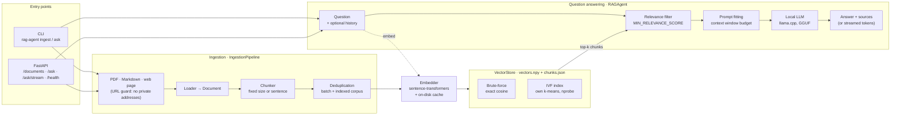
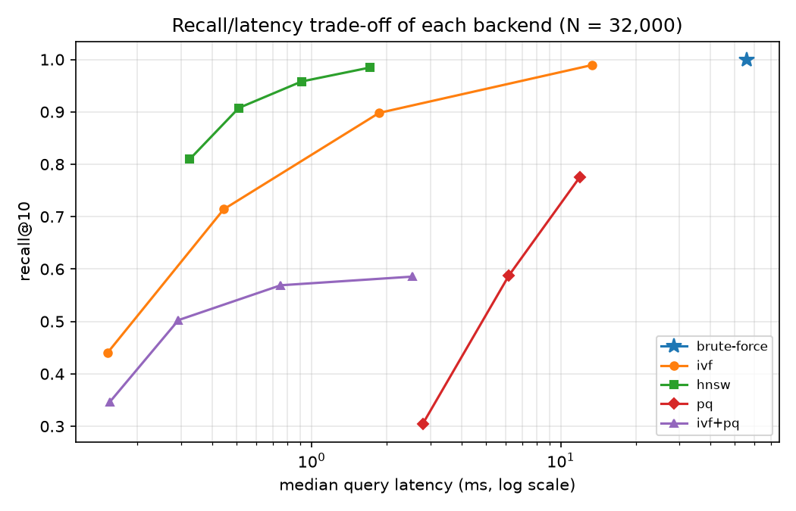

# RAG Agent

[](https://github.com/rmouahid/rag-agent/actions/workflows/ci.yml)

A minimal but precise Retrieval-Augmented Generation (RAG) agent built from scratch in Python — no LangChain, no managed vector database, no external ANN library.

## Features

- Multi-source ingestion (PDF, Markdown, Web)
- Custom chunking & embedding pipeline, built without a framework
- Vector search built from scratch with numpy: exact brute-force cosine search, an IVF index (own k-means, configurable `nprobe`, incremental updates) and an HNSW graph (multi-layer proximity graph, configurable `ef`, incremental insertion)
- Answer generation via a locally-hosted LLM — no external inference API

## Stack

- Python 3.11+
- llama.cpp via `llama-cpp-python` (local LLM, CPU-friendly GGUF weights)
- sentence-transformers (embeddings)
- numpy (vector search)

## Package layout

```
rag_agent/
├── ingestion/    # Source loaders (PDF, Markdown, web)
├── chunking/     # Text chunking
├── vectorstore/  # Embeddings, vector store, retrieval
├── generation/   # LLM-backed answer generation (RAGAgent)
├── api/          # FastAPI service (app, routers, dependencies)
└── pipeline.py   # Ingestion pipeline: source → indexed, searchable chunks
```

Ingestion goes through a single entry point, `IngestionPipeline`:
source → loader (picked from the file extension or URL) → chunker →
deduplication (against the batch and the indexed corpus) → embeddings →
vector store. `pipeline.ingest(path_or_url)` returns an `IngestionResult`
(new chunk ids, chunks produced, duplicates skipped);
`pipeline.ingest_document(document)` takes an already-loaded `Document`.
`RAGAgent` owns one, sharing the retriever's chunker, embedder and store,
so the CLI and the `POST /documents` endpoint both ingest through it.

Import everything via `rag_agent.*`, e.g. `from rag_agent.generation.rag_agent import RAGAgent`.

## Architecture



**Ingestion** turns a source into searchable chunks: the loader picked from
the file extension or URL produces a `Document`, which is chunked,
deduplicated against what is already indexed, embedded (cached by chunk id,
so re-ingesting costs nothing) and appended to the persisted vector store.
**Answering** embeds the question, retrieves the top-k chunks with the
configured backend (brute-force below `IVF_MIN_VECTORS`, IVF above it),
drops those below `MIN_RELEVANCE_SCORE` (no relevant chunk: a fixed reply,
the model is not called), fits the best ones and the recent history into
the model's context window, and generates the answer with the sources that
were actually in the prompt. The CLI and the API share the same code and the
same store.

## Local LLM

Answers are generated by a model running on your machine with llama.cpp
(see [ADR 0001](docs/ADR/0001-local-llm-runtime.md) for why). No API key,
no external inference service; the weights are a GGUF file on disk.

The default model is **Llama-3.2-3B-Instruct** (`Q4_K_M`, ~2 GB):

```bash
poetry run hf download bartowski/Llama-3.2-3B-Instruct-GGUF \
    Llama-3.2-3B-Instruct-Q4_K_M.gguf --local-dir models
```

`LOCAL_MODEL_PATH` points to it by default. To use another model, such as
`Llama-3.1-8B-Instruct` on a machine with more RAM, download its GGUF file
and change `LOCAL_MODEL_PATH`. No code change is needed. If the file is
missing, the agent stops at startup and prints the command above.

The prompt template (instructions, retrieved context with sources, recent
conversation history) lives in `rag_agent/generation/prompt.py`, apart
from the retrieval and generation code.

The prompt must fit in `LLM_CONTEXT_SIZE - LLM_MAX_TOKENS - LLM_CONTEXT_MARGIN`
tokens, so the answer always has room. When it would not, the least
relevant retrieved chunks are left out first (the best one is always kept),
then the oldest conversation exchanges. If the question and the best chunk
alone still overflow, the agent reports it instead of answering ungrounded.

Retrieved chunks scoring below `MIN_RELEVANCE_SCORE` are discarded. If none
is left, the agent answers that the indexed documents do not cover the
question, without calling the LLM, rather than letting it make an answer up.
With `all-MiniLM-L6-v2`, on-topic passages typically score 0.3 to 0.7 and
off-topic ones below 0.2.

`RAGAgent.ask` returns an `Answer`: the generated text plus the sources
actually placed in the prompt (source, excerpt, chunk id and similarity
score), so every answer can be checked against what the model was shown.
The CLI prints them as a numbered list under the answer.

`RAGAgent.ask_stream` is the streaming counterpart: it returns a
`StreamingAnswer` whose sources are known before the first token and
which yields the text as the model produces it (`LocalLLM.stream`). The
CLI uses it, so answers appear word by word.

| Variable | Default | Meaning |
|---|---|---|
| `LOCAL_MODEL_PATH` | `models/Llama-3.2-3B-Instruct-Q4_K_M.gguf` | GGUF weights |
| `LLM_CONTEXT_SIZE` | `4096` | Context window in tokens (prompt + answer) |
| `LLM_MAX_TOKENS` | `512` | Maximum tokens generated per answer |
| `LLM_TEMPERATURE` | `0.2` | Sampling temperature; low keeps answers close to the context |
| `LLM_CONTEXT_MARGIN` | `64` | Tokens kept free for the chat template around the prompt |
| `LLM_THREADS` | `0` | CPU threads, `0` lets llama.cpp choose |
| `HISTORY_TURNS` | `3` | Previous question/answer exchanges recalled in the prompt, `0` for none |
| `MIN_RELEVANCE_SCORE` | `0.25` | Minimum cosine similarity for a chunk to be used as context |

## Vector search

Three search backends, selected with `INDEX_TYPE` (see `.env.example`):

| `INDEX_TYPE` | How it works | When to use it |
|---|---|---|
| `brute-force` (default) | Exact cosine similarity against every stored vector. | Small corpora, and as the correctness baseline. |
| `ivf` | Inverted file index: a k-means (implemented from scratch) splits the vectors into `IVF_NLIST` lists; a query only scans the `NPROBE` lists whose centroids are closest to it. | Larger corpora, where scanning every vector gets slow. |
| `hnsw` | Hierarchical Navigable Small World graph (implemented from scratch): each vector is linked to its nearest neighbours on several layers; a query descends the sparse upper layers, then explores the bottom layer `HNSW_EF_SEARCH` candidates wide. | Larger corpora that keep growing: the graph absorbs new vectors without the drift and rebuilds of IVF. |

The index is persisted next to the store (`ivf_index.npz`) and reloaded on
startup; a missing or out-of-sync index is rebuilt automatically.

With `INDEX_TYPE=ivf`, a store smaller than **`IVF_MIN_VECTORS`** (default
`10000`) still searches by brute force and builds no index: at that size an
exact scan takes a few milliseconds (2 ms at 5,000 vectors in the
[benchmark](docs/benchmarks/ivf.md)), so the index would only cost recall
(0.79 at `NPROBE=8`) for no noticeable gain. The index is built by the
ingestion that reaches the threshold, and the store switches to it from
then on. Set `IVF_MIN_VECTORS=0` to use the index at any size.

`IVF_MIN_VECTORS` applies to both approximate indexes: below it, `hnsw`
also searches by brute force.

- **`IVF_NLIST`**: number of lists. `0` (default) picks about `sqrt(N)`.
- **`NPROBE`**: lists scanned per query, which trades speed for recall. Higher
  values give better recall but slower queries, and `NPROBE = IVF_NLIST` returns
  exactly the brute-force results. It can also be overridden per query with
  `VectorStore.search(..., nprobe=...)`.

### HNSW

The graph follows Malkov & Yashunin (2016), in numpy and plain Python:
each vector gets a random level (geometric law, so upper layers hold few
nodes), and is linked on every layer up to its level to at most
`HNSW_M` neighbours (`2 × HNSW_M` on the bottom layer). Neighbours are
chosen with the paper's diversity heuristic: a candidate is kept only if
it is closer to the new vector than to the neighbours already kept, which
keeps the graph navigable between nearby clusters.

- **`HNSW_M`** (default `16`): links per node. More links, better recall,
  more memory and slower inserts.
- **`HNSW_EF_CONSTRUCTION`** (default `100`): search width when inserting;
  it sets the quality of the graph.
- **`HNSW_EF_SEARCH`** (default `64`): search width per query, the
  recall/latency knob (like `NPROBE` for IVF). It can be overridden per
  query with `VectorStore.search(..., ef_search=...)`.

New vectors are inserted into the existing graph, so unlike IVF there is no
drift and no periodic rebuild. The graph is persisted as `hnsw_index.npz`
(the vectors themselves are not duplicated) and reloaded on startup.

Recall@10 against brute force, on 5,000 synthetic 384-dimensional vectors
(50 topics plus Gaussian noise), compared with the reference C++ library
[hnswlib](https://github.com/nmslib/hnswlib) built with the same `M` and
`ef_construction`:

| Data | `ef_search` | This project | hnswlib |
|---|---:|---:|---:|
| tight clusters (noise 0.1) | 16 | 0.969 | 0.957 |
| | 64 | 1.000 | 0.999 |
| near-random (noise 0.25) | 16 | 0.257 | 0.280 |
| | 64 | 0.591 | 0.620 |
| | 128 | 0.818 | 0.814 |
| | 256 | 0.941 | 0.941 |

Recall matches the reference implementation; the low values on the second
dataset come from the data, not the code: near-random vectors in high
dimension have no neighbourhood structure for any approximate index to
exploit, which real sentence embeddings do have. On the first dataset a
query takes about 0.3 ms at `ef_search=32` (recall 1.000) against 21 ms for
brute force, single CPU core. Building the graph is the cost: about 14 s
for 5,000 vectors in pure Python.

### Incremental updates vs. rebuilds

Re-running k-means every time a document is ingested would cost a full
pass over the corpus. So newly-ingested chunks are instead **filed into the
list of their nearest existing centroid**, and the centroids stay put. This
is cheap, but the centroids were fitted on the corpus as it was at build
time:

- if new documents cover the **same topics**, the old centroids still fit
  them. Recall barely moves, but the lists grow, and so does query latency.
- if new documents cover **new topics**, the new vectors get crammed into
  lists centred elsewhere. Recall then drops quickly, because a query about the
  new topic probes lists that are not the ones holding its neighbours.

To bound this drift, the store counts the vectors added since the last
build and **rebuilds the index from scratch** (new k-means, `IVF_NLIST`
re-derived from the new size) once they exceed `IVF_REBUILD_THRESHOLD`
of the index (default `0.2`, i.e. 20%). A lower threshold keeps recall
closer to a fresh index at the cost of more frequent rebuilds; a higher
one rebuilds less often but tolerates more drift. `VectorStore.rebuild_index()`
forces a rebuild at any time.

### Benchmark: brute-force vs. IVF

**In plain words.** Finding the passages closest to a question is like
looking for a book in a library. Brute-force reads the spine of every book:
it never misses, but it takes longer as the library grows. IVF first sorts
the books onto shelves by topic (the k-means lists); for a question it walks
only to the few shelves whose topic is closest (`NPROBE` of them) and reads
those. It is much faster, but a relevant book shelved under a neighbouring
topic can be missed. *Recall@10* measures exactly that: out of the 10
passages brute-force would return, how many IVF also finds. Probing more
shelves brings recall back up, at the cost of speed. The table below shows
where that trade-off lands on a real corpus.

Measured on **31,800 real chunks**: 40 public-domain books from Project
Gutenberg, split with the project's fixed-size chunker (500 characters)
and embedded with `all-MiniLM-L6-v2` (384 dimensions). The machine has a
single CPU core. Recall@10 is measured against the exact brute-force
top-10, over 200 held-out queries.

| Method | nprobe | Vectors scanned | Recall@10 | Median latency | Speed-up |
|---|---:|---:|---:|---:|---:|
| brute-force | — | 100% | 1.000 | 24.3 ms | 1x |
| IVF (178 lists) | 4 | 2.6% | 0.659 | 0.52 ms | 47x |
| IVF | 8 | 5.1% | 0.766 | 0.95 ms | 26x |
| IVF | 16 | 10.0% | 0.858 | 2.21 ms | 11x |
| IVF | 32 | 19.5% | 0.926 | 4.52 ms | 5.4x |
| IVF | 64 | 37.9% | 0.974 | 11.65 ms | 2.1x |


- `NPROBE` is the recall/latency knob. At this corpus size, `NPROBE=32`
  keeps over 92% of the exact neighbours while being about 5x faster than
  brute-force. The default `NPROBE=8` favours speed, at 0.77 recall.
- At a fixed `nprobe`, recall slowly decreases as the corpus grows, because
  the number of lists grows with it (about `sqrt(N)`). Larger corpora
  therefore need a larger `nprobe` for the same recall.
- Latencies include the float64 cosine computation over the scanned vectors
  (see `brute_force.py`), which both methods share.

Full results for 5k, 10k, 20k and 31.8k vectors are in
[`docs/benchmarks/ivf.md`](docs/benchmarks/ivf.md). To reproduce them, or
to run the benchmark on your own persisted store:

```bash
# any folder of .txt / .md files; it is chunked and embedded once into --store
python benchmarks/ivf_benchmark.py --corpus path/to/texts --store bench_store
python benchmarks/ivf_benchmark.py --store vector_db   # an existing store
```

The plot needs `matplotlib`, which is optional. Without it, only the
Markdown table is written.

### Benchmark: all backends (brute-force, IVF, HNSW, PQ, IVF+PQ)

Measured on **32,000 real chunks** drawn from a 120,000-chunk store (108
Project Gutenberg books, same chunker and embedding model as above), on
the same single-core machine. Memory is what a query needs: the float32
vectors plus the index structure, or only the codes and codebooks for PQ.

| Method | Setting | Recall@10 | Median latency | Speed-up | Memory | Build |
|---|---|---:|---:|---:|---:|---:|
| brute-force | exact scan | 1.000 | 56.0 ms | 1x | 46.9 MB | — |
| IVF (179 lists) | nprobe=16 | 0.898 | 1.87 ms | 30x | 47.6 MB | 5.6 s |
| IVF | nprobe=64 | 0.989 | 13.4 ms | 4.2x | 47.6 MB | 5.6 s |
| HNSW (M=16) | ef=32 | 0.907 | 0.51 ms | 110x | 53.5 MB | 113 s |
| HNSW | ef=64 | 0.958 | 0.91 ms | 61x | 53.5 MB | 113 s |
| HNSW | ef=128 | 0.985 | 1.71 ms | 33x | 53.5 MB | 113 s |
| PQ | m=48 (48 B/vector) | 0.588 | 6.20 ms | 9x | 2.2 MB | 174 s |
| PQ | m=96 (96 B/vector) | 0.775 | 11.9 ms | 4.7x | 3.7 MB | 444 s |
| IVF+PQ | m=48, nprobe=16 | 0.569 | 0.75 ms | 75x | 3.0 MB | 232 s |



- **HNSW gives the best recall for a given latency**: 0.96 recall under
  1 ms, where IVF needs about 13 ms for 0.99. It costs a slow build (about
  2 minutes for 32k vectors on one core) and 14% more memory for the graph,
  so it suits a store that is built once and queried often.
- **IVF builds in seconds** and stays the pragmatic choice for a store that
  is re-indexed often; `nprobe` trades recall for latency.
- **PQ trades recall for memory**: 21x less memory at m=48, but recall
  stays below 0.6, because codes this short cannot separate close
  neighbours among 384-dimensional embeddings. IVF+PQ makes it fast, not
  more accurate. It only makes sense when the vectors no longer fit in RAM,
  ideally followed by re-ranking the candidates against the full vectors.
- The brute-force scan was slower in this run than in the IVF benchmark
  above (56 ms against 24 ms), most likely because the machine was short
  of memory at the time. Compare speed-ups within one table, where every
  method ran under the same conditions.

Full results are in [`docs/benchmarks/ann.md`](docs/benchmarks/ann.md).
To reproduce them on a persisted store:

```bash
python benchmarks/ann_benchmark.py --store bench_store --sizes 32000 --name ann
```

## Retrieval pipeline

By default a question goes straight to the vector search. Optional steps,
each off by default and switched on in `.env`, trade latency for better
context:

### Query rewriting

With `QUERY_REWRITING=true`, the local LLM first rewrites the question into
up to `MAX_REWRITTEN_QUERIES` (default `3`) short search queries: one per
part of a multi-part question, follow-ups made self-contained from the
conversation ("and for bikes?"). The original question is always searched
too, so a poor rewrite can add passages but never lose the ones the question
found. Results are merged rank by rank (the best chunk of each query, then
the second ones, ...) so every sub-question keeps its best passages, even
when another one scores higher. Cost: one extra LLM call per question.

Compare with and without it on the golden dataset:

```bash
poetry run rag-agent eval --label baseline
poetry run rag-agent eval --rewrite --label rewrite
poetry run rag-agent eval --compare eval/runs/*-baseline eval/runs/*-rewrite
```

### Cross-encoder reranking

The vector search compares two embeddings computed separately: question and
chunk never "see" each other. With `RERANK=true`, the first
`RERANK_CANDIDATES` (default `20`) results are rescored by a cross-encoder
(`RERANKER_MODEL`, default `cross-encoder/ms-marco-MiniLM-L-6-v2`, about
90 MB, downloaded on first use) that reads each (question, chunk) pair
together, and only the best `top_k` reach the prompt, in that order. The
cosine score is kept for the `MIN_RELEVANCE_SCORE` filter, and when the
prompt must be shortened the chunk with the lowest cross-encoder score goes
first. Rewritten queries are reranked against the original question.

Measured on the golden dataset with `rag-agent eval --retrieval-only`
(context only, no LLM; real `all-MiniLM-L6-v2` embeddings, 1 CPU):

| | top_k = 3 | + reranking | top_k = 5 | + reranking |
|---|---:|---:|---:|---:|
| Evidence recall | 89.0% | **98.6%** | 97.6% | **100.0%** |
| MRR | 0.795 | **0.952** | 0.810 | **0.952** |
| Latency per question | < 0.1 s | 0.8 s | < 0.1 s | 0.8 s |

Reranking puts the passage that answers the question first in 95% of the
cases instead of 80%, so a smaller `top_k` (a shorter prompt, a faster
answer) loses almost nothing. The relevance threshold, on the other hand,
never rejects the 5 unanswerable questions: it is the LLM that must say the
documents do not answer, which the full evaluation measures.

### Agentic retrieval loop

A single retrieve-then-generate pass answers with whatever the first search
found, even when it is not enough. With `AGENTIC_LOOP=true`, the agent
decides: after each search, the local LLM reads the passages gathered so far
and replies either `ENOUGH`, or `SEARCH: <query>` with a new query for the
missing information. The new passages are added to the context and the loop
goes on, up to `AGENTIC_MAX_ITERATIONS` searches (default `3`, the first one
included).

- The decision comes **before** generating the answer: judging the context
  costs a few tokens, generating an answer only to throw it away would cost
  hundreds. The answer is generated once, on the final context.
- The loop stops on `ENOUGH`, on a query already tried (it would bring back
  the same passages), on a reply it cannot parse (rather than looping on
  noise) and at the iteration limit.
- Follow-up searches go through the same reranking and relevance filter as
  the first one; query rewriting applies to the first search only.
- Each search is logged with its query and the new sources it brought, and
  returned in `Answer.steps`; `rag-agent ask` lists them after the sources.

Cost: one short LLM call per extra search, plus the search itself.
`rag-agent eval --agentic` measures what it brings on the golden dataset
(answer quality and searches per question).

## Roadmap

This project is under active development. The full plan — local LLM migration, IVF/HNSW/PQ vector search, a FastAPI service, an answer-quality evaluation harness, and an agentic retrieval loop — is tracked as [GitHub milestones and issues](../../issues).

## Setup

```bash
poetry install
```

### Usage examples

A complete session, from an empty index to an answer. The examples ingest
`tests/fixtures/knowledge.md`, a short file on five unrelated topics shipped
with the repository; any PDF, Markdown file or web page works the same way.

**1. Download the model** (once, ~2 GB; see [Local LLM](#local-llm)):

```bash
poetry run hf download bartowski/Llama-3.2-3B-Instruct-GGUF \
    Llama-3.2-3B-Instruct-Q4_K_M.gguf --local-dir models
```

**2. From the command line**, ingest then ask:

```console
$ poetry run rag-agent ingest tests/fixtures/
tests/fixtures/knowledge.md: 4 chunks indexed (0 duplicates skipped)
4 chunks in vector_db

$ poetry run rag-agent ingest tests/fixtures/      # again: nothing new
tests/fixtures/knowledge.md: 0 chunks indexed (4 duplicates skipped)
4 chunks in vector_db

$ poetry run rag-agent ask "Who designed and built the Eiffel Tower?"
```

`ask` streams the answer as it is generated, then prints the numbered
sources it was built from.

**3. Over HTTP**, start the API (`poetry run uvicorn rag_agent.api.app:app
--port 8000`), then ingest a file or a web page:

```bash
# curl
curl -s -F file=@tests/fixtures/knowledge.md http://127.0.0.1:8000/documents
curl -s -F url=https://en.wikipedia.org/wiki/Eiffel_Tower http://127.0.0.1:8000/documents

# HTTPie
http -f POST :8000/documents file@tests/fixtures/knowledge.md
http -f POST :8000/documents url=https://en.wikipedia.org/wiki/Eiffel_Tower
```

```json
{"source": "knowledge.md", "chunks_created": 4, "chunk_ids": ["19776342f708f63f", "d7521b2f5f8fabb5", "bcc23b08db6eda1a", "fae56c140385d0d0"]}
```

Ask a question, as a single answer or as a stream:

```bash
# curl
curl -s http://127.0.0.1:8000/ask -H 'content-type: application/json' \
    -d '{"question": "How do worker bees tell their sisters where flowers are?", "top_k": 3}'
curl -N "http://127.0.0.1:8000/ask/stream?question=Who+created+Python%3F"

# HTTPie
http POST :8000/ask question="How do worker bees tell their sisters where flowers are?" top_k:=3
http --stream POST :8000/ask/stream question="Who created Python?"
```

The answer comes with the passages it used (`sources`) and a `status`;
the response formats, follow-up questions with `history` and every error
code are described in [Run the API](#run-the-api) below, and the
interactive documentation at `http://127.0.0.1:8000/docs` lets you try each
route from the browser.

### Command line

`poetry install` also installs a `rag-agent` command, for local use and quick
manual testing without running the API:

```bash
poetry run rag-agent ingest docs/ report.pdf https://example.com/page
poetry run rag-agent ask "Who built the Eiffel Tower?"
poetry run rag-agent ask --top-k 3 "How tall is it?"
poetry run rag-agent eval --judge --label baseline
```

- `ingest` takes files, folders (searched recursively for `.pdf`, `.md`
  and `.markdown` files) and http(s) URLs, and prints for each source the
  chunks indexed and the duplicates skipped. It only loads the embedding
  model, not the LLM, so it is quick. A source that fails is reported and
  the others are still ingested; the exit code is then `1`.
- `ask` streams the answer, then lists its sources. Without relevant
  indexed passages it says so instead of calling the model.

- `eval` asks every question of the golden dataset (`eval/golden/v1/`) and
  scores the answers: evidence recall, refusals, faithfulness, relevance
  and hallucination rate, with rules and optionally the LLM as a judge. It
  writes a report per run and compares runs with `--compare`. See
  [docs/evaluation.md](docs/evaluation.md).

`ingest` and `ask` use the vector store at `VECTOR_STORE_PATH`, the one the
API and `python main.py` (interactive ingestion then chat) use too: documents
ingested from the command line are available to the service. `eval` builds
its own in-memory index and leaves that store alone.

### Run the API

The HTTP service is a FastAPI app served by uvicorn:

```bash
poetry run uvicorn rag_agent.api.app:app --host 127.0.0.1 --port 8000
```

The model weights and the vector store are loaded once at startup (missing
weights stop it with the download command) and shared by all requests.
Interactive docs are at `http://127.0.0.1:8000/docs`.

#### `GET /health`

Checks that the model weights are loaded and that the vector store is
consistent (one vector per chunk, IVF index built), and answers `200` when
both pass, `503` otherwise, so it can be used as is for a Docker or load
balancer healthcheck:

```json
{"status": "ok", "checks": {"llm": true, "vector_store": true}, "indexed_chunks": 42, "model": "models/Llama-3.2-3B-Instruct-Q4_K_M.gguf"}
```

```bash
curl -fsS http://127.0.0.1:8000/health   # exits non-zero on 503
```

Requests and responses are typed Pydantic models (`rag_agent/api/schemas.py`),
documented field by field in the OpenAPI schema (`/openapi.json`). A
malformed body, including an unknown field, is rejected with `422` and the
offending field named.

Avoid `--reload` outside development: each reload loads the model again.

#### `POST /ask`

Answers a question from the indexed documents, with the sources used:

```bash
curl -s http://127.0.0.1:8000/ask -H 'content-type: application/json' \
    -d '{"question": "Who built the Eiffel Tower?", "top_k": 5}'
```

```json
{
  "answer": "Gustave Eiffel, for the 1889 World's Fair.",
  "status": "answered",
  "sources": [{"source": "france.md", "excerpt": "The Eiffel Tower was built by...", "chunk_id": "4b6d1eecef9805b6", "score": 0.5}]
}
```

`status` is `answered`, or `no_relevant_context` / `no_documents` when no
indexed passage reaches `MIN_RELEVANCE_SCORE` or nothing is indexed. Those
still return `200` with a fixed message and no sources: the model is not
asked to answer without grounding.

The API keeps no conversation state between calls. To ask a follow-up, send
the previous exchanges in `history` (oldest first, capped to
`HISTORY_TURNS`):

```json
{"question": "When was it built?", "history": [
  {"role": "user", "content": "Who built the Eiffel Tower?"},
  {"role": "assistant", "content": "Gustave Eiffel."}
]}
```

#### `POST /ask/stream` and `GET /ask/stream`

The same answer, streamed token by token as the model generates it, as
[Server-Sent Events](https://html.spec.whatwg.org/multipage/server-sent-events.html)
(`text/event-stream`). The stream sends, in order:

| Event | `data` |
|---|---|
| `sources` | `{"status": ..., "sources": [...]}`, as in `/ask`, before the first token |
| `token` | `{"text": "..."}`, one per generated piece |
| `done` | `{"answer": "..."}`, the full answer, then the stream ends |
| `error` | `{"error": ..., "detail": ...}` if generation fails; ends the stream |

`POST` takes the same JSON body as `/ask` (with `history`); `GET` takes
`question` and `top_k` as query parameters, for the browser's `EventSource`,
which can only send GET requests.

```bash
curl -N http://127.0.0.1:8000/ask/stream -H 'content-type: application/json' \
    -d '{"question": "Who built the Eiffel Tower?"}'
```

```
event: sources
data: {"status": "answered", "sources": [{"source": "france.md", "excerpt": "The Eiffel Tower was built by...", "chunk_id": "4b6d1eecef9805b6", "score": 0.5}]}

event: token
data: {"text": "Gustave"}

event: token
data: {"text": " Eiffel."}

event: done
data: {"answer": "Gustave Eiffel."}
```

In a browser, with `EventSource` (close it on `done`, or it reconnects and
asks again):

```js
const url = "/ask/stream?" + new URLSearchParams({ question: "Who built the Eiffel Tower?" });
const events = new EventSource(url);
events.addEventListener("sources", (e) => showSources(JSON.parse(e.data).sources));
events.addEventListener("token", (e) => (output.textContent += JSON.parse(e.data).text));
events.addEventListener("done", () => events.close());
events.addEventListener("error", (e) => {
  if (e.data) console.error(JSON.parse(e.data).detail); // server-side failure
  events.close();
});
```

To send `history`, `POST` with `fetch` and read `response.body` with a
`ReadableStream` reader, splitting the text on blank lines.

Questions and ingestions are processed one at a time: llama.cpp cannot run
concurrent generations on one model.

#### `POST /documents`

Ingests one source (chunking, embeddings, indexing) sent as multipart form
data, either a PDF or Markdown `file` or the `url` of an HTML page:

```bash
curl -F file=@notes.md http://127.0.0.1:8000/documents
curl -F url=https://example.com/article http://127.0.0.1:8000/documents
```

```json
{"source": "notes.md", "chunks_created": 3, "chunk_ids": ["96944874ef2c880e", "..."]}
```

Passages already indexed are skipped, so re-sending a source returns
`chunks_created: 0`. An unsupported file type or a non-HTML page returns
`415`, an unreachable URL `502`, and sending both or neither of `file` and
`url` returns `422`. Ingestions run one at a time.

URLs are fetched by the server, so they are checked first: a host that
resolves to a loopback, private, link-local or reserved address (localhost,
`192.168.x.x`, the cloud metadata endpoint...) is refused with `400`, and
every redirect is checked the same way. Set `ALLOW_PRIVATE_URLS=true` to
ingest pages from your own network.

Request bodies are capped at `MAX_UPLOAD_MB` (default 20 MB): a larger
upload is refused with `413` as soon as its `Content-Length` announces it,
and bodies sent without one (chunked) are counted as they arrive, so an
oversized file is never written to disk. The uploaded file name is only
kept as the source label: it is reduced to its last component (`/` and
`\` both count as separators) and never used as a path; the file itself
goes to a temporary file that is deleted after ingestion.

#### Errors

Every error response has the same shape, with a stable `error` code and a
readable `detail`; stack traces never reach the client, they stay in the
server logs:

```json
{"error": "unsupported_source", "detail": "Unsupported source 'data.xlsx': expected an http(s) URL or a .pdf, .md, .markdown file"}
```

| Status | `error` | When |
|---|---|---|
| 400 | `blocked_url` | The URL resolves to a non-public address |
| 404 / 405 | `not_found` / `method_not_allowed` | Unknown route or method |
| 413 | `payload_too_large` | Request body over `MAX_UPLOAD_MB` (default 20) |
| 415 | `unsupported_source` | Unsupported file type, non-http(s) URL or non-HTML page |
| 422 | `validation_error` | Malformed body; `detail` lists `{field, message, type}` per rejected field |
| 422 | `invalid_source` | Both or neither of `file` and `url` |
| 422 | `unreadable_file` | Corrupted PDF, non-UTF-8 Markdown |
| 422 | `context_overflow` | The question and history do not fit in the model context |
| 500 | `ingestion_failed` / `generation_failed` | Indexing or the model failed |
| 500 | `internal_error` | Any other unexpected error |
| 502 | `source_unreachable` | The URL could not be fetched |

Routes live in `rag_agent/api/routers/` and receive the agent, vector store
or LLM through the dependencies in `rag_agent/api/dependencies.py`; tests
swap them with `app.dependency_overrides` or `create_app(agent_factory=...)`.

## Docker

The `Dockerfile` builds the API image (llama.cpp compiled for any x86-64 CPU,
non-root user). Model weights, the vector store and the caches are mounted
as volumes, never copied into the image, so the image stays the same when
you change model and the index survives upgrades:

```bash
# put the GGUF weights in ./models first (see Local LLM)
docker compose up -d                     # build, then serve on 127.0.0.1:8000
docker compose logs -f                   # model loading, requests
```

| Path in the container | Content | Mounted from |
|---|---|---|
| `/app/models` | GGUF weights (read-only) | `./models` |
| `/app/vector_db` | vectors, chunks, IVF index | volume `index` |
| `/app/.cache` | embedding model download and computed embeddings | volume `cache` |

Settings come from `.env` (optional, see `.env.example`), as outside
Docker. The container's healthcheck calls `/health`, so `docker ps` shows
`healthy` once the model and the store are loaded (allow up to two minutes
on the first start, which also downloads the embedding model):

```bash
docker inspect -f '{{.State.Health.Status}}' rag-agent-rag-agent-1
```

Without Compose:

```bash
docker build -t rag-agent .
docker run -d -p 127.0.0.1:8000:8000 \
    -v "$PWD/models:/app/models:ro" -v rag-agent-index:/app/vector_db -v rag-agent-cache:/app/.cache \
    rag-agent
```

## Tests

```bash
poetry run pytest
```

The suite needs neither the GGUF weights nor network access, so it runs as
is in CI. `tests/` mirrors the package (`ingestion/`, `chunking/`,
`vectorstore/`, `generation/`, `api/`). `tests/conftest.py` holds the
fixtures shared by every folder:

| Fixture | Provides |
|---|---|
| `stub_llm` | LLM stand-in: fixed answer, records each prompt, `fail = True` makes it raise |
| `offline_embeddings` | Bag-of-words model instead of sentence-transformers (no download, similarity still meaningful) |
| `vector_store_dir` | Empty temporary `VECTOR_STORE_PATH`, with offline embeddings |
| `eiffel_text`, `sample_markdown`, `sample_pdf`, `make_pdf` | Sample documents, as text, files or in-memory PDFs |

API tests (`tests/api/`) use FastAPI's `TestClient`: unit tests swap the
agent for a fake, and `test_integration.py` runs the real `RAGAgent`
(loaders, chunking, vector store, relevance filter, prompt fitting) with
these fixtures, from upload to streamed answer, error paths included.

`tests/test_end_to_end.py` checks answer quality end to end, once per
search backend (brute force, IVF with 2 of 4 lists probed, and HNSW with a
sparse graph and a narrow search): it ingests
`tests/fixtures/knowledge.md` (five unrelated topics) and asks questions
whose answers are written in it. An extractive stand-in model answers
with the context sentence closest to the question, so the expected fact
only appears in the answer when retrieval put the right passage first.

## Code style

[black](https://black.readthedocs.io/) formats the code and
[ruff](https://docs.astral.sh/ruff/) lints it (configuration in
`pyproject.toml`, 120-character lines). Install the git hooks once:

```bash
poetry run pre-commit install
```

They then run on every commit. CI runs the same checks, so a commit made
with `--no-verify` is still caught. CI also type-checks the package with
[mypy](https://mypy.readthedocs.io/) (configuration in `pyproject.toml`:
every function must be annotated):

```bash
poetry run mypy
``` To check everything by hand:

```bash
poetry run pre-commit run --all-files
```

## Contributing

Contributions are welcome: see [CONTRIBUTING.md](CONTRIBUTING.md) for the
branch and commit conventions and the checks to run before opening a pull
request.

## License

[MIT](LICENSE)
